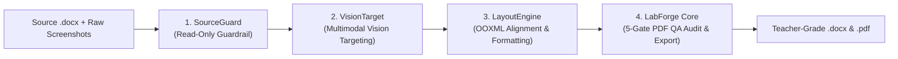

# ⚡ Project LabForge

**Zero-touch autonomous lab record automation engine & AI skill for Microsoft Word (`.docx`) and verified PDF generation.**

[](https://opensource.org/licenses/MIT)
[](https://www.python.org/downloads/)
[](https://colab.research.google.com/github/cid-moosa/labforge/blob/main/LabForge_Mobile.ipynb)
[](#the-7-solved-ooxml-layout-bugs)
[](.agents/skills/labforge/SKILL.md)

---

## 🌟 Overview

**Project LabForge** is an autonomous practical lab record automation engine built to eliminate the tedious hours spent manually formatting academic and technical lab records in Microsoft Word. It ingests unformatted source `.docx` documents and raw screenshots, applies multimodal vision targeting, solves notorious Word OpenXML layout bugs at the root, and exports publication-ready, teacher-grade `.docx` and `.pdf` deliverables on the first pass.

LabForge functions both as a **standalone Python CLI tool** and as an **autonomous AI Agent skill** (for Google Antigravity, Gemini CLI, Claude Code, and Cursor).

---

## 🎓 The Story Behind LabForge

It all started during our practical lab sessions in college. While running forensic tools, carving disk images, and typing commands into terminal windows, we’d capture dozens of screenshots as proof of our work. A few days later, our teacher would hand us the official practical record template and ask us to submit the completed document.

As an avid open-source enthusiast, I do everything on Linux with LibreOffice Writer rather than proprietary software. But sitting down to manually insert, crop, and align dozens of screenshots across multiple lab exercises was pure agony. Honestly, part of me was just lazy—I didn't want to spend entire weekends wrestling with image anchor settings, paragraph margins, and list indents.

To make matters worse, every time I manually aligned the document and exported the PDF, my teacher rejected it. The layout was always broken: list numbering pushed step numbers two inches into the middle of the page with awkward tab gaps, square dialog boxes were squeezed into unreadable thumbnails, headings were pressed right against preceding images with zero whitespace, and procedure steps sat stranded at the bottom of pages while their screenshots jumped to the next.

I got tired of the repeated rejections and manual alignment headaches, so I decided to solve it the hacker way: by building an automation engine to do all the heavy lifting.

With LabForge, the workflow is dead simple. I just create folders named `lab 1`, `lab 2`, `lab 4`, drop the teacher’s `.docx` template and my raw screenshots inside, and let the engine take over. It uses multimodal AI vision to understand which screenshot belongs to which step, fixes the underlying OpenXML layout with teacher-approved precision, and uses headless LibreOffice to generate the final, beautifully aligned PDF inside a `final/` folder—all with zero manual effort.

I don't know if this will be useful to anybody else out there, but it saved my records and my sanity. This project is built entirely with open-source tools and dedicated to my friends, future students who have to survive practical submissions, and fellow open-source nerds like me! 🚀

---

## ⚡ The One-Prompt Autonomous Setup (Zero Setup Required)

If you use any AI coding assistant (**Google Antigravity**, **Gemini CLI**, **Claude Code**, or **Cursor**), you don't even need to install or configure Python or virtual environments manually. 

Just copy and paste the universal master prompt from [PROMPT.md](PROMPT.md) into your AI assistant:

> *"You are an autonomous engineering agent executing Project LabForge (https://github.com/cid-moosa/labforge). Clone the repository, configure the environment, scan my `input/` folder, map all screenshots to the `.docx` procedure steps using multimodal AI vision, and generate the final teacher-approved `.docx` and verified `.pdf` deliverables inside `output/<lab_folder>/final/`."*

All you have to do is drop your lab folders into `input/` — the AI agent sets up dependencies, maps the screenshots, fixes the formatting bugs, compiles the PDF via LibreOffice, and runs the 5-gate QA audit autonomously!

---

### 💻 One-Command Terminal Installers (For Non-AI Users)

If you just want to set up the environment with a single terminal command:

- **Windows (PowerShell):**
  ```powershell
  irm https://raw.githubusercontent.com/cid-moosa/labforge/main/install.ps1 | iex
  ```
- **Linux / macOS (Bash):**
  ```bash
  curl -sSL https://raw.githubusercontent.com/cid-moosa/labforge/main/install.sh | bash
  ```

---

## 🏛️ The 4-Stage Core Architecture



1. **🛡️ SourceGuard (Immutable Read-Only Protection):**
   - Source files in `input/` are strictly **READ-ONLY**.
   - Zero text edits: never rewrites, deletes, or spellchecks the user's sacred text. The formatting bends to the text, never the reverse.
2. **👁️ VisionTarget (Multimodal Vision Mapping & Curation):**
   - Multimodal AI vision inspects raw screenshots, CLI commands, dialog titles, and highlight boxes.
   - Intelligently filters out transient timeline/loading clutter (e.g. intermediate splash screens) and maps definitive evidence images to exact paragraph indices in `.docx`.
3. **📐 LayoutEngine (Precision OOXML Alignment Engine):**
   - Operates directly at the OpenXML (`wordprocessingML`) level.
   - Strips Word list tab gaps, removes `<w:contextualSpacing/>`, wraps images in crisp 1px borders, scales aspect ratios, and dynamically unifies headers/footers.
4. **🚀 LabForge Core (Autonomous Pipeline & QA Audit):**
   - Runs the end-to-end pipeline and enforces a strict 5-gate automated PDF quality audit.

---

## 🔄 How It Works: The Automated Folder-to-Folder Workflow

LabForge eliminates manual copy-pasting through an intuitive, mirrored folder structure. You never have to worry about where your output goes or mess with manual file renaming:

```text
input/                                              output/
├── lab 1/                                          ├── lab 1/
│   ├── IDFT Lab 1 FTK Imager.docx       ───►       │   ├── IDFT Lab 1 FTK Imager - Final.docx
│   └── screenshots/                                │   └── final/
│       ├── 1.png, 2.png, ...                       │       └── IDFT Lab 1 FTK Imager - Final.pdf
├── lab 2/                                          ├── lab 2/
│   ├── IDFT Lab 2 Autopsy.docx          ───►       │   ├── IDFT Lab 2 Autopsy - Final.docx
│   └── autopsy images/                             │   └── final/
│       ├── 1.png, 2.png, ...                       │       └── IDFT Lab 2 Autopsy - Final.pdf
└── lab 4/                                          └── lab 4/
    ├── IDFT Lab 4 Guymager.docx         ───►           ├── IDFT Lab 4 Guymager - Final.docx
    └── guymager images/                                └── final/
        ├── Screenshot_1.png, ...                           └── IDFT Lab 4 Guymager - Final.pdf
```

### 📋 The 4-Step User Experience:
1. **Create Separate Lab Folders in `input/`**:
   Simply create a folder for each practical experiment (e.g., `input/lab 1`, `input/lab 2`, `input/lab 4`).
2. **Drop Your Files Inside**:
   Place the teacher's blank practical record template (`.docx`) and all the raw screenshots you took during the lab into that folder. No need to rename the images or arrange them beforehand.
3. **Run LabForge**:
   LabForge automatically scans all folders in `input/`, inspects the procedure steps, uses AI vision to map the right screenshots to each step, and fixes low-level OpenXML layout issues.
4. **Collect Mirrored Deliverables in `output/`**:
   LabForge replicates the exact folder structure inside `output/`. The formatted Word document stays in `output/lab <N>/`, and the final, teacher-approved PDF is neatly isolated inside `output/lab <N>/final/`.

---

## ✨ Key Features & Capabilities

- 📁 **Automated Lab Folder Discovery & Mirroring:** Scans `input/` for unbuilt labs, ignores folders without screenshots until you're ready, and outputs cleanly structured folders under `output/<lab_folder>/final/`.
- 🛡️ **SourceGuard Read-Only Protection:** Source documents and screenshots in `input/` are never overwritten, modified, or deleted.
- 👁️ **Multimodal AI Vision Targeting:** Intelligently pairs screenshots with document steps by analyzing terminal commands, window headers, and GUI dialogs, discarding transient loading/splash screens.
- 📐 **Direct OpenXML Layout & Spacing Engine:** Fixes 7 notorious formatting bugs directly in the document's XML—eliminating hanging step tab gaps, unsticking paragraphs from borders, centering screenshots, and preventing split steps.
- 🖼️ **Aspect-Ratio Smart Bounding Boxes & 1px Borders:** Widescreen terminal windows and square dialog boxes are scaled proportionally and framed in crisp 1px borders so buttons and menus are never clipped.
- 📄 **Dynamic Headers & Single-Line Footers:** Injects native dynamic Word page numbers (`1 | Page` through `N | Page`), prevents odd/even page header desync, and ensures footer text never wraps across lines.
- 🖨️ **100% Open-Source PDF Compilation:** Converts documents to publication-grade PDFs via headless LibreOffice without requiring any paid or proprietary software.
- 🔍 **Automated 5-Gate PDF QA Auditor:** Verifies every generated PDF against 5 strict acceptance criteria before you submit it to your teacher.
- 📱 **Mobile & Cloud Ready (Google Colab):** Classmates without computers can run the complete pipeline directly on their Android or iPhone in a mobile web browser.
- 🤖 **Zero-Touch Agentic Integration:** Fully executable via AI agents (Antigravity, Gemini CLI, Claude Code, Cursor) using the `/labforge` slash command.

---

## 🛠️ The 7 Solved OOXML Layout Bugs

Standard Word automation tools produce broken layouts because Microsoft Word hides formatting overrides in low-level XML. LabForge resolves all 7 root causes:

| Bug | Root Cause in Word OpenXML | LabForge Engine Fix |
|---|---|---|
| **1. Hanging Step Numbers** | Native `<w:numPr>` list numbering pushes step numbers 2 inches toward the center. | Preserves literal number prefix, strips `<w:numPr>` and `<w:tabs>`, applies clean 0.3" hanging indent. |
| **2. Congested Spacing** | Word's `<w:contextualSpacing/>` silently cancels out paragraph margins. | Injects `<w:contextualSpacing w:val="0"/>` and enforces explicit vertical buffers (`Pt(16)` before / `Pt(12)` after). |
| **3. Off-Center Images** | Inserted image paragraphs inherit preceding list indentations. | Resets paragraph to `Normal` style, zeros horizontal indents, and enforces true page centering. |
| **4. Orphaned Step Text** | Empty spacer paragraphs glue step text to bottom of page. | Cleans spacer elements and binds step text to its screenshot via `keep_with_next=True` and `keep_together=True`. |
| **5. Split Multi-Bullet Steps** | Inserting images directly after step intro splits sub-bullets (`a, b, c, d`). | VisionTarget maps screenshots strictly after the final sub-bullet, keeping all explanations grouped. |
| **6. Distorted / Page-Breaking Images** | Fixed image heights or single width limits cause dialog blowouts or tiny thumbnails. | Aspect-ratio bounding boxes (5.80"×2.65" widescreen, 4.80"×2.60" dialogs, 4.80"×2.00" output) with 1px black borders. |
| **7. Doubled Headers & Broken Footers** | `odd_and_even_pages_header_footer` duplicates headers and wraps text across lines. | Unifies sections, dynamically inserts `<w:fldSimple w:instr="PAGE">`, and expands footer textboxes with non-breaking hyphens. |

---

## 🚀 Quick Start

### 1. Prerequisites
- **Python 3.10+**
- **LibreOffice** (required for headless `.docx` → `.pdf` conversion)
  - Windows: Default path `C:\Program Files\LibreOffice\program\soffice.exe`
  - Linux: `sudo apt install libreoffice`
  - macOS: `brew install --cask libreoffice`

### 2. Installation
```bash
git clone https://github.com/cid-moosa/labforge.git
cd labforge
python -m venv .venv
source .venv/bin/activate  # On Windows: .venv\Scripts\activate
pip install -e .
```

### 3. Usage (CLI)

```bash
# 1. Scan and inspect unbuilt lab folders:
python scripts/inspect_record.py --scan

# 2. Inspect a specific lab document and catalog screenshots:
python scripts/inspect_record.py --dir "input/my_lab" --out "mappings/my_lab_inspection.json"

# 3. Execute LabForge engine:
python scripts/labforge_engine.py --docx "input/my_lab/record.docx" --mapping "mappings/my_lab_map.json" --out "output/my_lab/record - Final.docx"

# 4. Audit the generated PDF against all 5 quality acceptance gates:
python scripts/verify_pdf.py --pdf "output/my_lab/final/record - Final.pdf" --mapping "mappings/my_lab_map.json"
```

---

## 📱 Running on Phone / Mobile (No Computer Needed)

If your classmates or friends don't have a PC or laptop, they can run Project LabForge directly inside their smartphone web browser (Chrome, Safari, Firefox) via Google's free cloud environment:

[](https://colab.research.google.com/github/cid-moosa/labforge/blob/main/LabForge_Mobile.ipynb)

### 📲 Step-by-Step Mobile Instructions:
1. Tap the **Open in Colab** badge above on your smartphone.
2. Tap the **Play (▶)** button on **Step 1 & Step 2** to initialize cloud LibreOffice and Python.
3. In **Step 3**, tap **Choose Files** to upload your unformatted lab `.docx` and screenshots from your phone gallery/storage.
4. In **Step 4**, enter your free Google Gemini API key ([aistudio.google.com/apikey](https://aistudio.google.com/apikey)) so AI vision maps the images to the right procedure steps.
5. In **Step 5 & Step 6**, the engine formats the document and automatically downloads the finished `.docx` and `.pdf` directly to your phone's Downloads folder!

---

## 🤖 AI Agent Integration (/labforge)

Project LabForge includes a pre-packaged AI Agent skill in `.agents/skills/labforge/SKILL.md`.

Whenever you work with an AI assistant (Google Antigravity, Gemini CLI, Claude Code, or Cursor), simply invoke:
```text
/labforge
```
The agent reads the skill standard, inspects screenshots using vision, generates the coordinate mapping, builds the formatted `.docx`, auto-converts to `.pdf`, and outputs a verified QA audit report autonomously.

---

## 📋 The 5-Gate Automated PDF Audit

Every generated PDF is audited against 5 non-negotiable acceptance criteria:

1. **Zero Trailing Blank Page**: Verifies the final page contains genuine body/output content.
2. **Zero Orphaned Steps**: Confirms no procedure step text sits stranded at the bottom of a page without its screenshot.
3. **Sequential Page Headers**: Validates dynamic sequential page numbering (`1 | Page` through `N | Page`).
4. **All Screenshots Accounted For**: Verifies all curated screenshots are properly embedded in the PDF.
5. **Footer Single-Line Format**: Validates that institution name and academic year text remain strictly on a single line.

---

## 📂 Project Structure

```text
labforge/
├── .agents/
│   └── skills/
│       └── labforge/
│           └── SKILL.md            # AI Agent Skill Definition
├── scripts/
│   ├── labforge_engine.py         # Core OOXML Alignment & PDF Engine (LayoutEngine)
│   ├── inspect_record.py          # Document & Screenshot Inspector (VisionTarget)
│   ├── verify_pdf.py              # 5-Gate PyMuPDF Quality Auditor
│   └── inject_images.py           # Backward-compatible wrapper
├── mappings/                      # Versioned JSON image-to-paragraph mappings
├── pyproject.toml                 # Standard Python package configuration
├── requirements.txt               # Dependencies
├── CONTRIBUTING.md                # Contribution Guidelines
├── LICENSE                        # MIT License
└── README.md                      # Project Documentation
```

---

## 📄 License

Distributed under the [MIT License](LICENSE). Copyright (c) 2026 cid-moosa.
